 

I'm an **AI Developer at OMICS International** in Hyderabad and a B.Tech CSE (AI & ML) graduate (2026).
I build **agentic RAG systems, document-intelligence engines and developer tools** — software that takes messy, unstructured input and returns answers you can trust.

 

| | Quest | |
|:--:|---|---|
| 🔴 | **Self-Corrective RAG** — answers that grade, retry and cite themselves | *in progress* |
| 🔴 | **Voice-Driven Coding Agent** — plan, search and edit code by voice | *in progress* |
| ⚪ | **Graph RAG with Neo4j** — knowledge graphs for complex reasoning | *next* |
| ⚪ | **Multi-Agent Orchestration** — async agents that reach consensus | *next* |

 

 

 

<picture>
  <source media="(prefers-color-scheme: dark)" srcset="https://raw.githubusercontent.com/Nitro-Builds-Yash/Nitro-Builds-Yash/output/snake-dark.svg" />
  
</picture>

  

