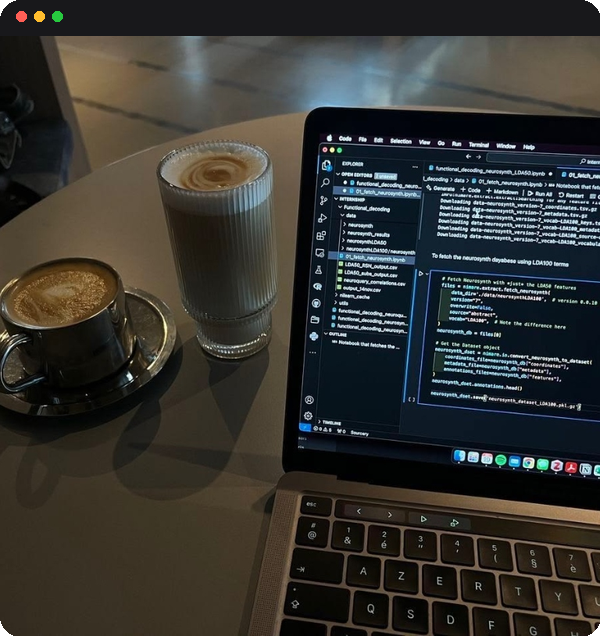

  <!-- Knock Code Pictures -->
  <picture>
    <source media="(prefers-color-scheme: dark)" srcset="https://cdn.jsdelivr.net/gh/sun0225SUN/sun0225SUN/assets/images/coding.gif" />
    <source media="(prefers-color-scheme: light)" srcset="https://cdn.jsdelivr.net/gh/sun0225SUN/sun0225SUN/assets/images/icon.png" height="225px" />
    
  </picture>

  <!-- Developer Workspace Aesthetic Banner -->
  

    
  

  <!-- Dynamic Typing Headline -->
  

    
  

  <!-- Executive HUD Status Badges -->
  

    
    
    
    
  

<!-- Welcome words -->
<h1 style="color: #FFC0CB;">Welcome to Yashwanth's GitHub &#x1F680;</h1>

**AI Developer | Software Engineer | Systems Architect**  

B.Tech CSE (AI & ML) graduate with expertise in full-stack development, multi-modal artificial intelligence, and scalable microservices.  
Demonstrated expertise in engineering deterministic knowledge extraction engines, agentic RAG architectures, and biomedical intelligence platforms.  
Skilled in Python, Java, JavaScript, TypeScript, C/C++, Dart, and modern frameworks including PyTorch, FastAPI, Spring Boot, LangChain, and Docker.

---

## &#x1F52D; Mission Directives (What I'm Working On)
&#x1F916; **AI & Agentic Systems:** Multi-modal document chunking, self-corrective Agentic RAG (CRAG), voice-assisted coding agents  
&#x1F310; **Web & Microservices:** High-performance asynchronous backends, responsive UIs with FastAPI, Flask & Spring Boot  
&#x26A1; **Data Platforms:** Biomedical literature intelligence, automated PDF data extraction & Excel reporting  
&#x1F50C; **Backend Systems:** Enterprise REST APIs with strict RBAC, JWT auth, and pessimistic concurrency locking  

---

## &#x2694;&#xFE0F; Tech Arsenal & Skill Inventory

  <b>Languages & Core Runtimes</b> 
  

  <b>AI, Agentic Frameworks & Deep Learning</b> 
  
  
  
  

  <b>Backend Architecture, Database & DevOps</b> 
  

---

<h1>&#x1F31F; Campaign Quests & Featured Projects</h1>

## &#x1F916; AI-Powered Automation & Agents

**[halo](https://github.com/Nitro-Builds-Yash/halo)** &nbsp; `[DIFFICULTY: MYTHIC]`  
A production-ready self-corrective QA assistant where users upload PDFs and perform deep multi-document reasoning with confidence scores, citations, and LangGraph fallback web search.

**[OmniChunk](https://github.com/Nitro-Builds-Yash/OmniChunk)** &nbsp; `[DIFFICULTY: LEGENDARY]`  
Universal multi-modal chunking, relational structure extraction, and context-preserving knowledge engine with zero information loss.

---

## &#x1F9E0; AI & Developer Tooling

**[voxcode](https://github.com/Nitro-Builds-Yash/voxcode)** &nbsp; `[DIFFICULTY: EPIC]`  
Voice-assisted AI coding agent combining AST symbol extraction, BM25 + dense hybrid search, planning state machines, live diffing, and STT/TTS.  

---

## &#x1F310; Web & Data Platforms

[**pulsus-regain**](https://github.com/Nitro-Builds-Yash/pulsus-regain) &nbsp; `[DIFFICULTY: ANCIENT]`  
Cinematic spatial portfolio and autonomous research outreach engine with real-time 3D spatial visualization.

[**OmniScout**](https://github.com/Nitro-Builds-Yash/OmniScout) &nbsp; `[DIFFICULTY: ENTERPRISE]`  
Biomedical Literature & Author Intelligence Platform across 55 repositories with search filters, automated PDF contact extraction, and Excel export.  
  
[**Aetherium-Simulation**](https://github.com/Nitro-Builds-Yash/Aetherium-Simulation) &nbsp; `[DIFFICULTY: HARD]`  
A streamlined and secure backend model for cryptocurrency transactions, demonstrating Mongoose schema design and transaction tracking.  
  
[**resource-booking-api**](https://github.com/exelynt-learning-platform/backend-developer-as-final-71072-athota) &nbsp; `[DIFFICULTY: HARD]`  
High-throughput Spring Boot REST API with strict RBAC, JWT authentication, and pessimistic concurrency locking.  

---

## &#x1F331; Currently Leveling Up
&#x26A1; Advanced **Multi-Agent Orchestration** & asynchronous consensus  
&#x1F680; **FastAPI & uv** for low-latency scalable AI API backends  
&#x1F52E; **Graph RAG & Neo4j** knowledge graphs for complex document reasoning  

---

## &#x1F91D; Open to Collaborate On
&#x1F4A1; **AI Research & Agent Projects** (NLP, Multimodal, RAG)  
&#x1F6E0;&#xFE0F; **Open-source developer utilities & tools**  
&#x1F3E2; **High-concurrency backend services & cloud architecture**  

---

## &#x1F4EB; Reach Me At
 &#x1F310; Portfolio: [athotayashwanth.vercel.app](https://athotayashwanth.vercel.app/)  
 &#x2709;&#xFE0F; Email: **yashwanthchowdhury749@gmail.com**  
 &#x1F4BB; GitHub: [github.com/Nitro-Builds-Yash](https://github.com/Nitro-Builds-Yash)  
 &#x1F4BC; LinkedIn: [linkedin.com/in/athota-yashwanth](https://linkedin.com/in/athota-yashwanth)  

---

## &#x26A1; Fun Fact
I love breaking complex, chaotic engineering problems down into clean deterministic state machines and AI agents ? turning unstructured data into verified knowledge! Curiosity is my superpower!  

---

## &#x1F4CA; GitHub Telemetry & Stats

  
  

  

---

<!--
? This repository is special because its `README.md` appears on your GitHub profile.  
-->

