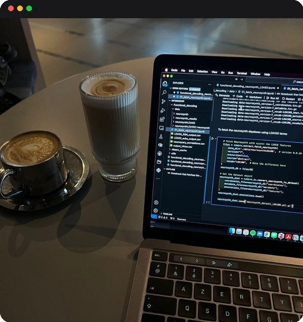

<!-- Header -->


<div align="center">

<a href="https://athotayashwanth.vercel.app">
  
</a>

<br/>

<a href="https://athotayashwanth.vercel.app"></a>
<a href="https://linkedin.com/in/athota-yashwanth"></a>
<a href="mailto:yashwanthchowdhury749@gmail.com"></a>


</div>

<div align="center">

```text
            ▄▄▄▄▄▄▄▄▄▄▄▄▄▄▄▄▄▄▄▄▄▄▄▄▄▄▄▄▄▄▄▄▄▄▄▄▄▄▄
          ▄▀  ⚠  BAT-SIGNAL DETECTED OVER GOTHAM  ⚠  ▀▄
          █    Incoming request: "Hire an AI Developer"    █
          ▀▄   Responding unit: YASHWANTH · ETA: now    ▄▀
            ▀▀▀▀▀▀▀▀▀▀▀▀▀▀▀▀▀▀▀▀▀▀▀▀▀▀▀▀▀▀▀▀▀▀▀▀▀▀▀
                     LOADING BATCAVE ... ██████████ 100%
```

</div>

<div align="center">

```text
╔══════════════════════════════════════════════════════════════╗
║  🦇 PLAYER: YASHWANTH        CLASS: AI DEVELOPER      LVL 22 ║
║  HP  ████████████████████  100/100   (coffee-powered)        ║
║  XP  ██████████████░░░░░░  7,400 / 10,000 → next: Senior Dev ║
║  STATUS: 🟢 ONLINE · ON PATROL IN HYDERABAD                   ║
╚══════════════════════════════════════════════════════════════╝
```

<sub>▶ PRESS START TO CONTINUE ◀</sub>

</div>

---

## 🦇 Player Profile



```yaml
player:      Athota Yashwanth
class:       AI Developer  ·  Systems Architect
guild:       OMICS International  (Hyderabad, IN)
origin:      B.Tech CSE (AI & ML) — MLRITM, 2026
alignment:   Builds in the dark, ships in the light
main_quest:  Turn unstructured chaos into verified knowledge
```

**Ability Stats**

```text
Agentic AI / RAG   ██████████████████░░  90
Backend Systems    ████████████████░░░░  80
Document Intel     █████████████████░░░  85
Full-Stack Web     ██████████████░░░░░░  70
Detective Work     ████████████████████  99  (debugging)
```

<br clear="right"/>

---

## 🗺️ Active Quests

| Status | Quest | Objective |
|:---:|---|---|
| 🟡 In progress | **Self-Corrective RAG** | CRAG pipelines that grade, retry and cite their own answers |
| 🟡 In progress | **Multi-Modal Chunking** | Preserve structure across text, tables and images |
| 🟡 In progress | **Voice-Driven Coding Agent** | Plan, search and edit code by voice |
| 🔒 Unlocking | **Graph RAG + Neo4j** | Knowledge graphs for complex document reasoning |
| 🔒 Unlocking | **Multi-Agent Orchestration** | Async agents that reach consensus |

---

## 🗂️ Case Files — Featured Projects

<table>
<tr>
<td width="50%" valign="top">

### [🛡️ halo](https://github.com/Nitro-Builds-Yash/halo)
`RANK S` · Self-corrective QA assistant: upload PDFs and get multi-document reasoning with **confidence scores, citations** and a LangGraph web-search fallback.


</td>
<td width="50%" valign="top">

### [🎙️ voxcode](https://github.com/Nitro-Builds-Yash/voxcode)
`RANK S` · Voice-driven AI coding agent with **AST symbol extraction**, BM25 + dense hybrid search, a planning state machine, live diffs and STT/TTS.


</td>
</tr>
<tr>
<td width="50%" valign="top">

### [🧩 OmniChunk](https://github.com/Nitro-Builds-Yash/OmniChunk)
`RANK A` · Universal multi-modal chunking engine that extracts relational structure and preserves context, with **zero information loss**.


</td>
<td width="50%" valign="top">

### [🌌 pulsus-regain](https://github.com/Nitro-Builds-Yash/pulsus-regain)
`RANK A` · Cinematic spatial portfolio and autonomous research-outreach engine with **real-time 3D visualisation**.


</td>
</tr>
<tr>
<td width="50%" valign="top">

### 🔬 OmniScout <sub>(classified · private)</sub>
`RANK A` · Biomedical literature & author-intelligence platform across 55 sources — search filters, automated PDF contact extraction and Excel export.


</td>
<td width="50%" valign="top">

### [📅 resource-booking-api](https://github.com/exelynt-learning-platform/backend-developer-as-final-71072-athota)
`RANK B` · High-throughput Spring Boot REST API with strict **RBAC, JWT auth** and pessimistic concurrency locking.


</td>
</tr>
</table>

<sub>Side mission: [Aetherium-Simulation](https://github.com/Nitro-Builds-Yash/Aetherium-Simulation) — secure crypto-transaction backend demonstrating Mongoose schema design and transaction tracking.</sub>

---

## 🌃 Gotham City Map — Areas I Patrol

```text
   ┌──────────────────────── G O T H A M ─────────────────────────┐
   │  🏙️ WAYNE TOWER          │  🧪 ACE CHEMICALS                 │
   │  AI / Agentic Systems    │  Data Pipelines & PDF Extraction  │
   │  threat: ▓▓▓▓▓ cleared   │  threat: ▓▓▓▓░ contained          │
   ├──────────────────────────┼───────────────────────────────────┤
   │  🏛️ GCPD HQ              │  🌉 THE NARROWS                   │
   │  Backend APIs · RBAC     │  Concurrency & Race Conditions    │
   │  threat: ▓▓▓▓▓ cleared   │  threat: ▓▓▓░░ under patrol       │
   ├──────────────────────────┴───────────────────────────────────┤
   │  🦇 THE BATCAVE — R&D: Graph RAG · Multi-Agent Swarms         │
   └──────────────────────────────────────────────────────────────┘
```

---

## 🎒 Gadget Inventory

| Slot | Gadget | Effect | Rarity |
|:---:|---|---|:---:|
| 1 | 🪝 **Grapnel Retriever** | Hybrid BM25 + dense search — pulls the right chunk from any height | 🟪 Epic |
| 2 | 🔍 **Forensic Scanner** | AST symbol extraction — sees inside any codebase | 🟪 Epic |
| 3 | 🛡️ **Self-Correcting Armor** | CRAG grader — blocks hallucinations, reflects citations | 🟧 Legendary |
| 4 | 🧩 **Evidence Splitter** | Multi-modal chunker — no clue left behind | 🟧 Legendary |
| 5 | 🔐 **Cowl Lock** | JWT + RBAC — only the right people get in | 🟦 Rare |
| 6 | 📦 **Containment Pod** | Docker — every villain in its own cell | 🟦 Rare |
| 7 | ☕ **Alfred's Coffee** | +50 focus, removes "sleepy" debuff | ⬜ Common (infinite) |

---

## 🌳 Skill Tree

```text
                         [ 🦇 AI DEVELOPER ]
                                  │
        ┌─────────────────────────┼─────────────────────────┐
        │                         │                         │
  [ 🧠 AI / ML ]          [ ⚙️ BACKEND ]            [ 📄 DATA INTEL ]
   ├─ ✅ PyTorch             ├─ ✅ FastAPI             ├─ ✅ PDF Extraction
   ├─ ✅ LangChain           ├─ ✅ Spring Boot         ├─ ✅ Multi-modal Chunking
   ├─ ✅ LangGraph (CRAG)    ├─ ✅ JWT + RBAC          ├─ ✅ Hybrid Search (BM25)
   ├─ ✅ Vector DBs          ├─ ✅ Docker              ├─ 🔒 Graph RAG (Neo4j)
   └─ 🔒 Multi-Agent Swarms  └─ 🔒 Distributed Queues  └─ 🔒 Knowledge Graphs

   ✅ unlocked   🔒 unlocking — next skill point incoming
```

---

## 👹 Boss Battles Defeated

| Boss | Weakness Exploited | Loot |
|---|---|---|
| 🃏 **The Hallucinator** — LLM making things up | Self-grading CRAG loop + citations | Confidence scores in `halo` |
| ❓ **The Riddler of PDFs** — tables, images, broken layouts | Structure-aware multi-modal chunking | `OmniChunk` engine |
| 🐧 **The Race Condition** — double bookings | Pessimistic locking | Concurrency-safe booking API |
| 🦹 **The Needle in the Codebase** — finding the right symbol | AST extraction + BM25/dense hybrid search | `voxcode` retrieval |

---

## 🧰 Utility Belt — Tech Stack

| Slot | Gear |
|---|---|
| **Languages** |  |
| **AI / ML** |     |
| **Backend** |  |
| **Data & DevOps** |  |

---

## 📓 Patrol Log

```diff
+ [NIGHT 01] Graduated from the academy — B.Tech CSE (AI & ML)
+ [NIGHT 02] Joined OMICS International as AI Developer
+ [NIGHT 03] Defeated The Hallucinator — halo goes live
+ [NIGHT 04] Cracked the Riddler's PDFs — OmniChunk deployed
+ [NIGHT 05] Taught the code to listen — voxcode online
! [TONIGHT ] Investigating Graph RAG in the Batcave...
- [PENDING ] Your team's toughest AI problem — send the signal 🦇
```

---

<details>
<summary><b>🕵️ Activate Detective Mode</b> <sub>(click to scan)</sub></summary>

<br/>

```text
[DETECTIVE MODE: ON] ── scanning subject ─────────────────────────
  ▸ Primary weapon ....... Python
  ▸ Fighting style ....... Agentic RAG · state machines · clean APIs
  ▸ Known allies ......... LangGraph, FastAPI, PyTorch, Docker
  ▸ Weakness ............. Unfinished side projects at 3 AM
  ▸ Threat to bugs ....... EXTREME
  ▸ Recommended action ... Recruit immediately
[ANALYSIS COMPLETE] ────────────────────────────────────────────
```

</details>

<details>
<summary><b>❓ Riddle me this…</b></summary>

<br/>

> *"I have answers, but no memory of where I got them. Give me sources and I stop lying. What am I?"*

<details>
<summary>Reveal answer</summary>

An LLM without RAG. 🦇 *Case closed.*

</details>
</details>

---

## 🏆 Trophy Cabinet

<div align="center">

</div>

## 🏅 Achievements Unlocked

| | Achievement | |
|:---:|---|---|
| 🎓 | **Graduated** | B.Tech CSE (AI & ML), 2026 |
| 💼 | **Joined the Guild** | AI Developer at OMICS International |
| 🛡️ | **Self-Correcting Mind** | Shipped a CRAG engine with citations & confidence scores |
| 🎙️ | **Voice of the Code** | Built a voice-driven coding agent |
| 🔐 | **Gatekeeper** | RBAC + JWT + concurrency-safe booking API |

---

## 📡 Batcomputer Telemetry

<div align="center">


<br/><br/>

<picture>
  <source media="(prefers-color-scheme: dark)" srcset="https://raw.githubusercontent.com/Nitro-Builds-Yash/Nitro-Builds-Yash/output/snake-dark.svg" />
  
</picture>

<br/><br/>

<sub>🦇 <i>"It's not who I am underneath, but what I ship that defines me."</i></sub>

</div>

---

<div align="center">

### 💾 Save Point — Join the Party

[](https://athotayashwanth.vercel.app)
[](https://linkedin.com/in/athota-yashwanth)
[](mailto:yashwanthchowdhury749@gmail.com)

<sub>Open to co-op missions: AI/agent research · open-source dev tools · high-concurrency backends</sub>

```text
GAME SAVED ✔   Thanks for playing. Continue? [Y/N]
```

</div>


