<div align="center">

<a href="https://athotayashwanth.vercel.app"></a>

<a href="https://athotayashwanth.vercel.app"></a>
<a href="https://linkedin.com/in/athota-yashwanth"></a>
<a href="mailto:yashwanthchowdhury749@gmail.com"></a>


<br/><br/>




<br/><br/>




<br/><br/>


<a href="https://github.com/Nitro-Builds-Yash/halo"></a>
<a href="https://github.com/Nitro-Builds-Yash/voxcode"></a>
<a href="https://github.com/Nitro-Builds-Yash/OmniChunk"></a>
<a href="https://github.com/Nitro-Builds-Yash/pulsus-regain"></a>

<a href="https://github.com/exelynt-learning-platform/backend-developer-as-final-71072-athota"></a>

<br/><br/>





<br/><br/>


<br/><br/>


<picture>
  <source media="(prefers-color-scheme: dark)" srcset="https://raw.githubusercontent.com/Nitro-Builds-Yash/Nitro-Builds-Yash/output/snake-dark.svg" />
  
</picture>

</div>

<details>
<summary><b>🕵️ Activate Detective Mode</b></summary>

```text
▸ weapon ........ Python        ▸ allies ...... LangGraph · FastAPI · PyTorch
▸ threat to bugs  EXTREME       ▸ verdict ..... recruit immediately
```
</details>

<details>
<summary><b>❓ Riddle me this</b></summary>

*I have answers but no memory of where I got them. Give me sources and I stop lying. What am I?*
<details><summary>Reveal</summary>An LLM without RAG. 🦇</details>
</details>

<div align="center">
<br/>

</div>
